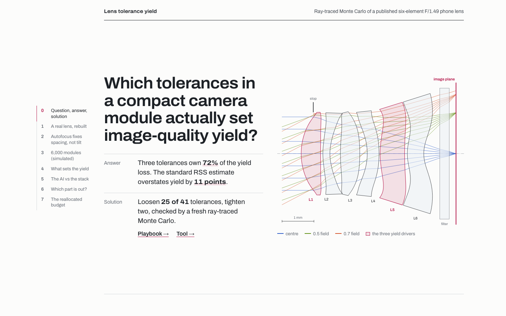
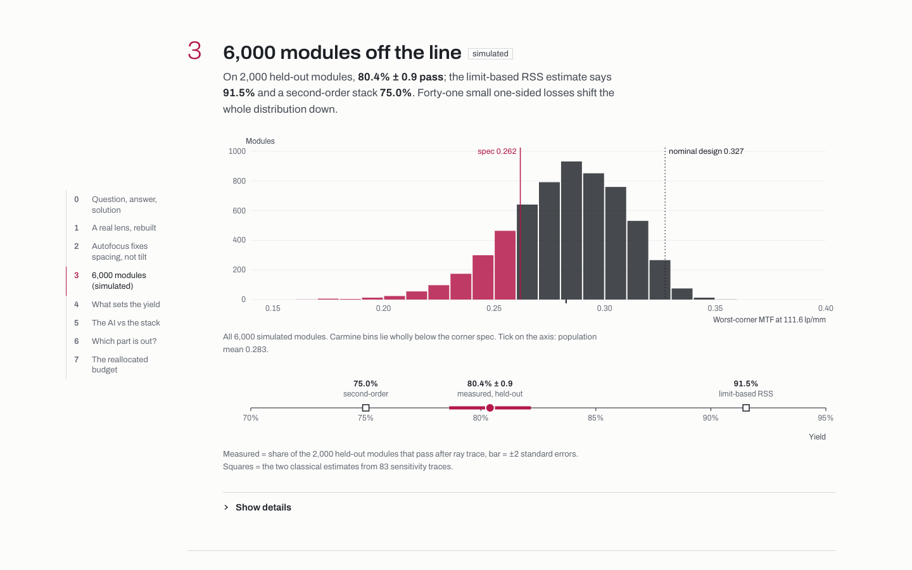
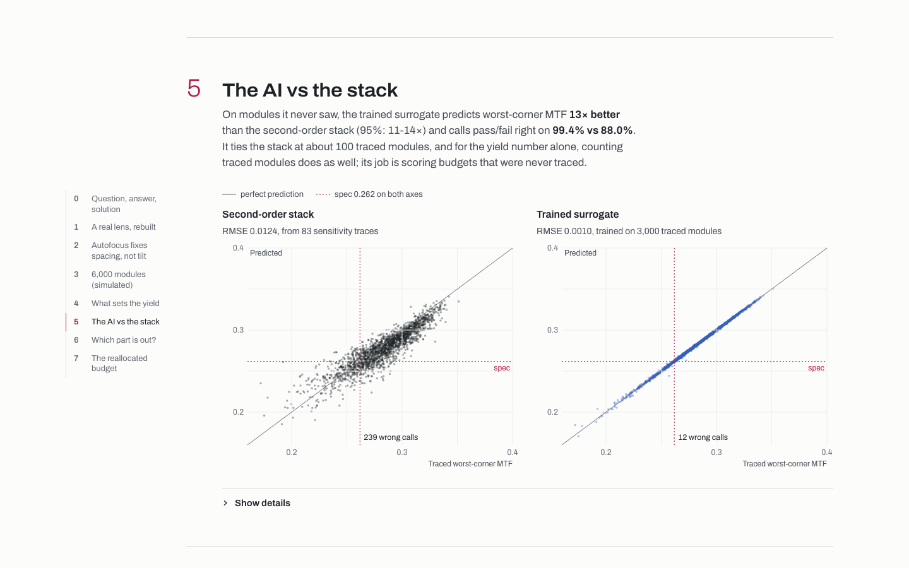
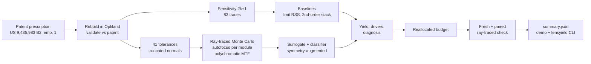
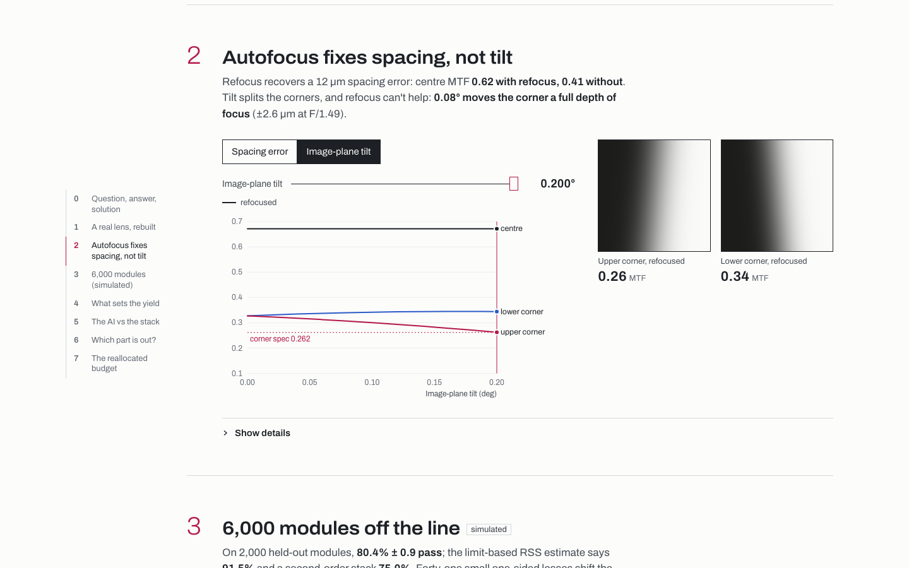

# Lens Tolerance Yield

**Which mechanical tolerances in a compact camera lens actually set image-quality yield once autofocus has done its job? Three of them, and the standard RSS stack overstates yield by 11 points. Measured by ray-tracing 6,000 simulated modules of a published six-element phone lens.**

[](tests/)
[](LICENSE)
[](data/prescription_us9435983_e1.json)
[](requirements.txt)
[](web/package.json)

<a href="https://ibiraheel.com/demos/lens-tolerance-yield/"></a>

**[Live demo →](https://ibiraheel.com/demos/lens-tolerance-yield/)** · [METHOD.md](METHOD.md) · [SOLUTION.md](SOLUTION.md)

---

## The question

A camera module's tolerance budget is set part by part: lens decenter and tilt, centre thickness, spacers, the barrel seat, the sensor die. Autofocus takes out spacing errors but not tilt or decenter. A sensitivity-plus-RSS estimate is quick, but it treats one-sided MTF losses as zero-mean, ignores interactions and gives no yield distribution. So a budget can end up tight where it doesn't matter and loose where it does. Which tolerances set the yield, and how far off is the stack?

## The answer

**Three near-tied tolerances own 72% of the yield loss: L1 decenter, image-plane tilt and L5 decenter.** Each one, made perfect, would recover about 8 yield points. On 2,000 held-out modules the measured yield is 80.4% ± 0.9. The limit-based RSS stack predicts 91.5%, 11 points high. A second-order stack predicts 75.0%, 5 points low.



## The solution

A reallocated tolerance budget. It loosens 25 of the 41 tolerances, tightens two parts (L1 decenter and L2 centre thickness) and leaves 13 alone, for a 20% lower cost proxy. It was checked by re-tracing the same 2,000 held-out modules on the new limits: yield moved −0.85 ± 0.68 points (95% interval −2.2 to +0.5), so the cheaper budget costs about 1 point.

[SOLUTION.md](SOLUTION.md) is the playbook and week-1 plan for a real module line. The `lensyield` CLI runs the same analysis on another prescription and tolerance table, and names the likely culprit part from a failing module's through-field MTF.

## Key results

Every number comes from [`results/summary.json`](results/summary.json). [METHOD.md](METHOD.md) has the intervals, equations and caveats.

| Measure | Result |
|---|---|
| Simulated modules, ray-traced (train / validation / held-out) | 6,000 (3,000 / 1,000 / 2,000) |
| Yield, held-out modules | **80.4%** ± 0.9 (79.2% ± 0.5 on all 6,000) |
| Baseline A: limit-based RSS, 83 traces | 91.5% (**+11.1 pts**) |
| Baseline B: second-order stack, same 83 traces | 75.0% (−5.4 pts) |
| Baseline B calibrated with 1,000 extra traced modules | 75.9% (−4.5 pts) |
| Failing modules that fail on a corner | 1,246 of 1,248 |
| Top three drivers, share of yield loss | L1 decenter 24.6%, image-plane tilt 23.6%, L5 decenter 23.4% (**72%** together) |
| Driver spot check by direct ray trace (top three made perfect, 500 modules) | +19.4 ± 1.8 pts traced vs +19.1 pts predicted |
| Reallocated budget | 25 loosened, 2 parts tightened, 13 unchanged; cost proxy **−20.3%** |
| Reallocated budget, paired re-trace of the 2,000 held-out modules | 79.6% vs 80.4%: **−0.85 ± 0.68 pts** (83 flipped to pass, 100 to fail) |
| Reallocated budget, fresh independent Monte Carlo (3,000 modules) | 79.2% ± 0.7 |
| Lens rebuild vs patent: EFL, TTL, element focal lengths | within 0.6% (EFL 3.428 vs 3.43 mm, TTL 4.851 vs 4.85 mm) |

## AI vs baseline

Two trained models, each scored only on modules it never saw.

**The surrogate** is a neural net that adds a learned correction to the second-order stack. It trains on the lens's exact rotational symmetry (8 images of every module) and was picked from six candidates on validation error alone.

| Test (2,000 held-out modules) | Trained surrogate | Second-order stack | Verdict |
|---|---|---|---|
| Worst-corner MTF error (RMSE) | **0.0010** | 0.0124 | **Win.** 13× smaller (95% interval 11–14×) |
| Pass/fail call accuracy | **99.4%** (12 wrong) | 88.0% (239 wrong) | **Win.** +10 to +13 pts |
| Population yield (truth 80.4%) | 80.4% | 75.0% | Surrogate is right, but see the next row |
| Population yield vs counting the 3,000 traced training modules | 80.4% | 79.0% ± 0.7 (counting) | **Tie.** Both within sampling noise of the truth |

For the yield number alone, the surrogate is no better than counting traced modules. Its measured win is per module: it scores a budget that was never traced, which is what the driver ranking and the reallocation need. A gradient-boosted model was also tried and lost to the stack on yield (88.2%, +7.8 pts).



**The diagnosis classifier** reads a failing module's through-field MTF (9 fields × 2 frequencies × tangential/sagittal) and names the culprit part.

| Test (247 held-out failing modules, 21 culprit classes) | Classifier | Signature lookup | Verdict |
|---|---|---|---|
| Top-1 culprit | **72%** (66–77%) | 49% (43–55%) | **Win.** +16 to +29 pts, paired bootstrap |
| Top-2 culprit | **84%** | 62% | **Win** |
| Chance, top-1 | 13% | | |

## How it works



- **Lens.** The published prescription rebuilt in [Optiland](https://github.com/HarrisonKramer/optiland). EFL, TTL, entrance pupil and all six element focal lengths match the patent within 0.6%, and the field curves match the patent's plots.
- **Modules.** 41 mechanical tolerances, each tied to a drawing callout with a GD&T hand calc, sampled as truncated normals (limit = 2σ). Every simulated module gets its own autofocus best focus. MTF is the polychromatic pupil autocorrelation of the traced wavefront, (T+S)/2 at 111.6 lp/mm (Nyquist/4 for a 1.12 µm pixel).
- **Spec.** Centre MTF ≥ 90% of nominal and every corner ≥ 80% of the nominal worst corner.
- **Hand checks.** Autofocus recovers a 12 µm despace (centre MTF 0.62 with refocus, 0.41 without). Sensor tilt splits the corners, and 0.08° moves a corner by one depth of focus (2.6 µm), which the trace matches.



## Quickstart

**Demo** (reads precomputed JSON in `web/public/data`, no API keys, no GPU):

```bash
cd web
npm install
npm run dev          # http://localhost:5173/demos/lens-tolerance-yield/
npm run build        # static site in web/dist/, built for /demos/lens-tolerance-yield/
```

**Tests and pipeline** (Python 3.12):

```bash
python3.12 -m venv .venv && .venv/bin/pip install -r requirements.txt
.venv/bin/python -I -m pytest -q tests        # 30 tests, about 30 s

# full pipeline: rebuild, every Monte Carlo, analysis, verification (about 2.5 h on 4 cores)
PYTHON=.venv/bin/python ./run_pipeline.sh

# or re-run only the analysis on the committed ray-traced runs in data/runs/ (minutes)
.venv/bin/python -I -c "import sys; sys.path.insert(0, '.'); from pipeline import analyze as A; A.main(['yield','surrogates','drivers','diagnosis','scrubs','verify','export'])"
```

**The `lensyield` tool:**

```bash
# tolerance CSV -> yield, both stacks, ranked drivers, a reallocated table
.venv/bin/python -I tool/lensyield.py run --prescription data/prescription_us9435983_e1.json \
  --tolerances tool/example_tolerances.csv --modules 400 --out out/

# a failing module's through-field MTF -> ranked likely culprits (model and lookup)
.venv/bin/python -I tool/lensyield.py diagnose --mtf tool/example_failing_module.csv
```

`run` writes `tolerances_reallocated.csv`; verify it with a second `run --tolerances` on a new seed. Input formats are documented at the top of [`tool/lensyield.py`](tool/lensyield.py).

## Repo layout

```
pipeline/            lens rebuild, MTF engine, module sampler, Monte Carlo, stacks, surrogate, analysis
tests/               30 pytest checks: patent first-order values, MTF vs diffraction, hand-calc physics, stacks, symmetry
tool/                lensyield CLI + example tolerance and failing-module CSVs
data/                patent prescription (JSON) and the committed ray-traced runs (data/runs/*.npz)
results/             summary.json, validation.json, reallocated budget, trained model weights
web/                 React + TypeScript guided demo (reads web/public/data)
docs/img/            screenshots used here
METHOD.md            equations, assumptions, validation, limitations
SOLUTION.md          playbook and week-1 plan for a module line
run_pipeline.sh      every stage in order; run_mc.sh runs one Monte Carlo stage
```

## Limitations

- **Simulated modules.** The population is a physics simulation of a published design under stated tolerance assumptions. It is not measured line data, and the tolerance sizes are assumptions ([METHOD.md](METHOD.md), section 3).
- **Rigid-body tolerances only.** Surface form, index and Abbe lot variation, element wedge, stray light and lens-actuator tilt during focus are not modelled.
- **Fields stop at 0.7 of the diagonal half-field.** The outer asphere zones break the intersection solver near full field, so real corner performance at full field will be worse.
- **Focus is the only compensator.** Active alignment (focus plus tilt) would recover much of the image-plane tilt loss.
- **The reallocation trades about 1 point.** The paired re-trace puts the new budget 0.85 points below the current one, with an interval from −2.2 to +0.5. The cost proxy (sum of current/new limit) stands in for real part cost.
- **The surrogate needs traces.** It ties the stack at about 100 training modules and wins clearly from about 400; it was trained on 3,000.
- **Single-culprit diagnosis.** The classifier is trained on simulated failures with one part out. Real failures can have two.

## Data and credit

- **Lens design (real):** US 9,435,983 B2, first embodiment, Tables 1–2, transcribed from the USPTO full text into [`data/prescription_us9435983_e1.json`](data/prescription_us9435983_e1.json). US patent text is not under copyright; it is used here with citation.
- **Module population (simulated):** generated by this repo from that published design ([METHOD.md](METHOD.md), section 3). It is labelled as simulated everywhere it appears.
- **Ray tracing:** [Optiland](https://github.com/HarrisonKramer/optiland) 0.6.3, MIT licence.

## Author

**Ibi Raheel** · mechanical engineer building AI tools · [ibiraheel.com](https://ibiraheel.com)
